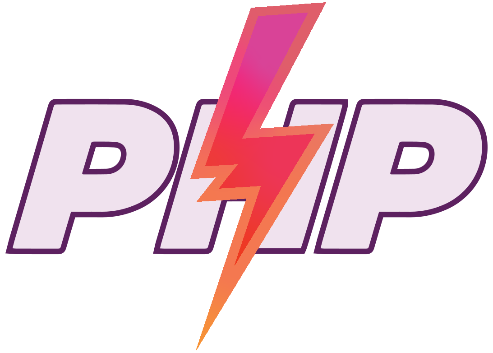
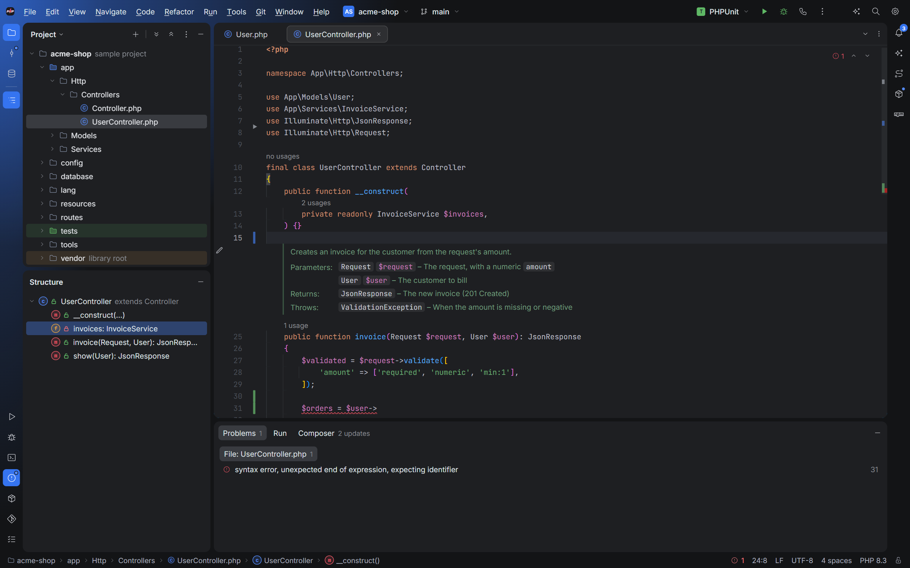
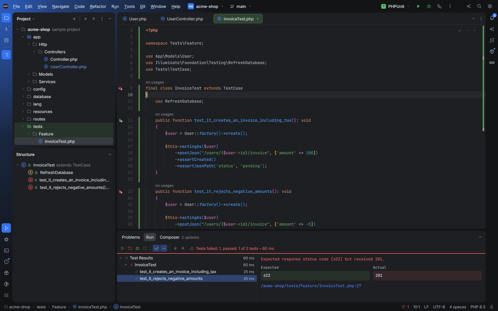
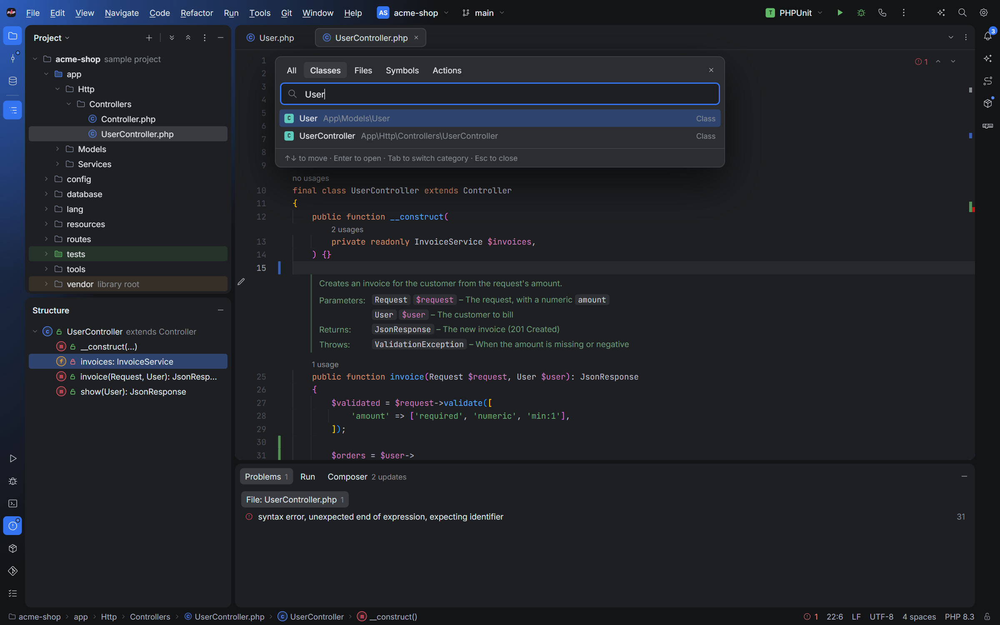
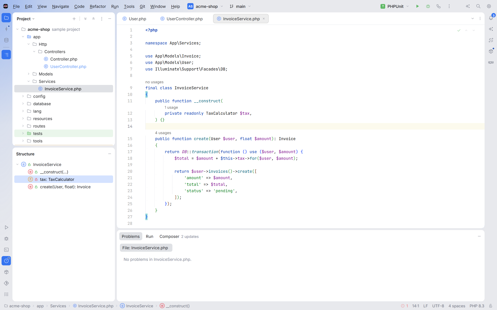
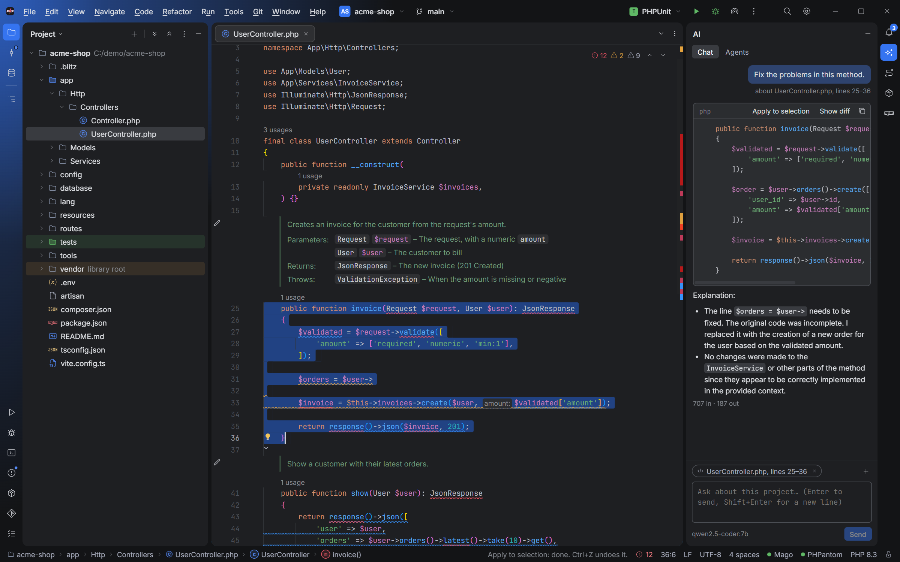
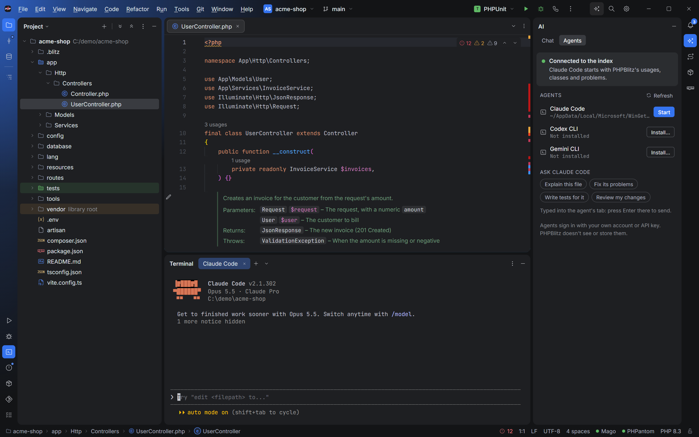
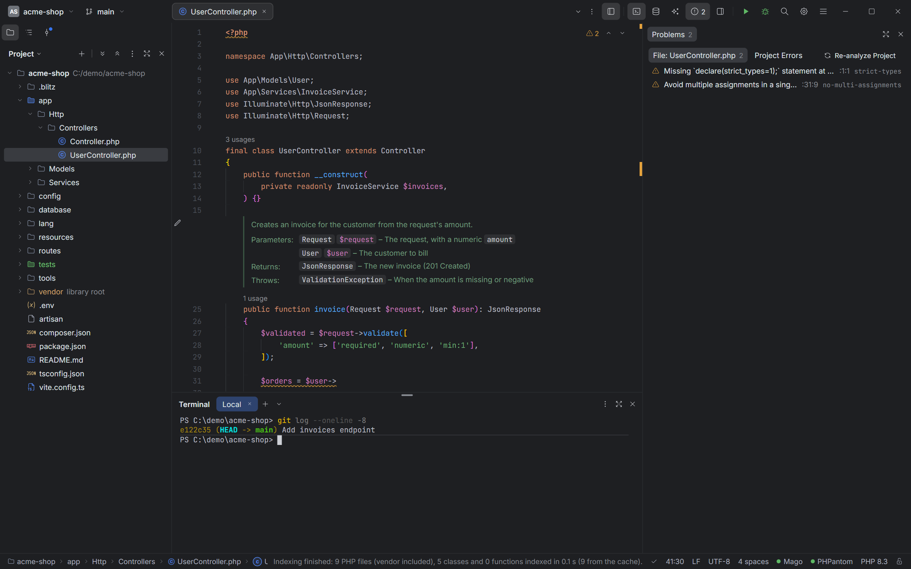
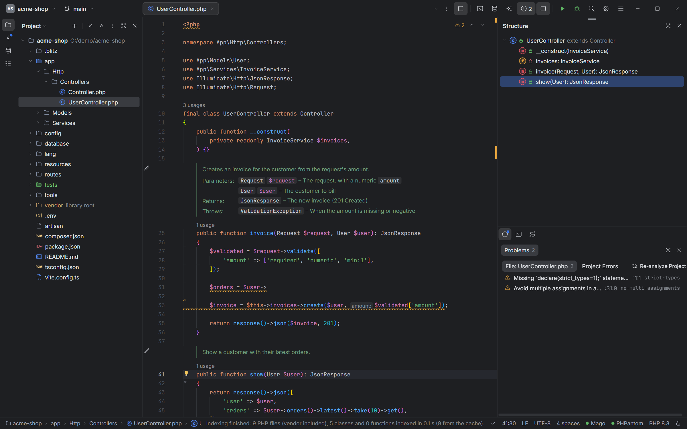
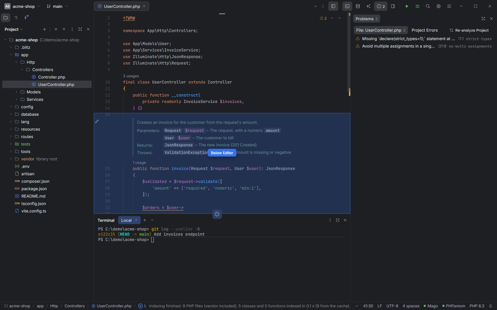

<h1 align="center">
  
</h1>

<p align="center">
  <b>A fast, open source PHP IDE.</b><br>
  Built with Rust and <a href="https://tauri.app">Tauri</a>, with the <a href="https://microsoft.github.io/monaco-editor/">Monaco</a> editor
  and <a href="https://github.com/carthage-software/mago">Mago</a> for PHP analysis.<br>
  Free for everyone, commercial use included. Your code stays on your machine.
</p>

<p align="center">
  <a href="LICENSE"></a>
  
  
  
</p>

<p align="center">
  <a href="#download">Download</a> ·
  <a href="https://phpblitz.com/">Documentation</a> ·
  <a href="#what-it-does">Features</a> ·
  <a href="#build-from-source">Build</a> ·
  <a href="#security">Security</a> ·
  <a href="#license">License</a> ·
  <a href="#thank-you">Credits</a>
</p>

<p align="center">
  
</p>

PHPBlitz takes its workflow from the IDEs PHP developers already know: tool windows, Search
Everywhere, Find Usages, Rename, Alt+Enter fixes, the same keyboard shortcuts. It's an independent
project, written from scratch, and opens big projects quickly on modest machines.

> [!IMPORTANT]
> **Status:** PHPBlitz is young (version 0.x). The everyday editing, navigation, analysis and Git
> features work; the debugger, the database tools and the AI agent support are newer. Expect
> rough edges, and please [report what you find](https://github.com/bilelbho/phpblitz/issues):
> include your system, the PHPBlitz version and, for slowness, the report from
> **Help ▸ Startup Performance** (it has a Copy Report button).

## Download

Get the latest version from [Releases](https://github.com/bilelbho/phpblitz/releases/latest):

| System | File |
| --- | --- |
| Windows 10/11 (64-bit) | `PHPBlitz_<version>_x64-setup.exe` (installer) or `.msi` |
| Windows, no install | `PHPBlitz_<version>_windows-x64-portable.zip`: unzip, run `PHPBlitz.exe` |
| macOS 11+ (Apple Silicon and Intel) | `PHPBlitz_<version>_universal.dmg` |
| Ubuntu, Debian | `.deb` |
| Fedora, openSUSE | `.rpm` |
| Other Linux | `.AppImage` (no install: make it executable and run it) |

Each release lists every file's SHA-256 checksum in `SHA256SUMS.txt`. The apps aren't signed by a
certificate yet, so the first launch needs one extra step (check the checksum first, see
[SECURITY.md](SECURITY.md#known-limits)):

- **Windows:** SmartScreen may warn about an unknown publisher: choose *More info ▸ Run anyway*.
- **macOS:** the first time, macOS refuses to open it; go to *System Settings ▸ Privacy & Security*
  and click *Open Anyway* next to PHPBlitz.
- **Windows portable:** needs the WebView2 runtime, which Windows 11 and updated Windows 10 include.

PHP, Git and Composer on your PATH turn on running PHP, tests, the Git tools and package updates.

## What it does

<table>
  <tr>
    <td></td>
    <td></td>
    <td></td>
  </tr>
  <tr>
    <td align="center">Tests: gutter icons, results, failures</td>
    <td align="center">Search Everywhere</td>
    <td align="center">Light theme</td>
  </tr>
</table>

<table>
  <tr>
    <td></td>
    <td></td>
  </tr>
  <tr>
    <td align="center">AI chat: here with a local model through Ollama</td>
    <td align="center">AI agents: Claude Code with your own account</td>
  </tr>
</table>

<table>
  <tr>
    <td></td>
    <td></td>
    <td></td>
  </tr>
  <tr>
    <td align="center">Focus layout: tabs in the top bar, panels as columns</td>
    <td align="center">Panels stacked and grouped, icons on any side</td>
    <td align="center">Drag a panel anywhere: the hint says where</td>
  </tr>
</table>

- **Layouts**: Classic (tool window bars and a bottom panel) or Focus (Settings ▸ Appearance ▸
  Layout): the editor tabs in the top bar, panels in columns side by side, stacked or grouped as
  tabs, the editor a panel like the others. Drag a panel by its header, icon or grip beside, above,
  below or into another; resize anything; save a layout as a preset (Window ▸ Layouts). F6 moves
  between panels, Ctrl+Shift+F12 maximizes one. The layout is kept for each project.
- **Editor**: PHP highlighting, completion, rendered doc comments, bookmarks, soft wrap, Markdown preview,
  TODO comments (with a TODO tool window). Typos in names, comments and strings get a green wavy
  underline (camelCase and snake_case names are split into words); Alt+Enter renames to the
  correction or saves the word to the project's dictionary. The lock in the status bar makes a
  file read-only.
- **Local History**: every save is kept, also the versions you never committed. Right-click a file ▸
  *Local History…* shows each version as a diff against the current text and reverts to it in one
  undoable step.
- **Navigation without a language server**: Go to Definition (Ctrl+B), Find Usages (Alt+F7), Show
  Usages (Ctrl+Alt+F7) and Rename (Shift+F6) work from PHPBlitz's own index of your project and `vendor/`,
  cached in the project's `.blitz` folder. Back and Forward (Ctrl+Alt+← / →, or the mouse's side
  buttons) retrace your jumps, Recent Locations (Ctrl+Shift+E) lists where you've been and what you
  changed, and Ctrl+Shift+T reopens the last closed tab.
- **Errors as you type**: Mago's linter and PHPStan-like analyzer are built in. Open files are checked
  right away; the whole project is analyzed in the background. Framework rules (Laravel, Symfony,
  PHPUnit, Doctrine…) come from `composer.json`.
- **JavaScript and TypeScript**: .js, .jsx, .ts and .tsx files get completion, errors as you type,
  documentation, Go to Declaration, Find Usages, Rename and quick fixes, across the project: a
  Laravel front end in `resources/js`, a Vue or React app or a Node tool in a subfolder. PHPBlitz
  reads their `tsconfig.json`/`jsconfig.json` (path aliases like `@/`) and the types of their
  packages in `node_modules`. The **npm** tool window lists each `package.json` with its scripts
  and runs them in the terminal.
- **Git**: change markers, diff viewer, commit, push and pull, branches, log with graph, annotations
  (blame), stash. The Commit window has amend and fixup commits, AI commit messages and a menu on
  every file and group (commit only these, Add to .gitignore, Copy as Patch…); *Rollback…* opens a
  panel where you check the files to put back.
- **Databases**: PostgreSQL, MySQL/MariaDB and SQLite: schema tree, query consoles, table data, table
  editing. *Add from .env* fills in the connection from Laravel's `DB_*` or Symfony's `DATABASE_URL`.
  Passwords stay in your system's credential store.
- **Tests**: PHPUnit and Pest. ▶ in the gutter beside each test class, test method and Pest test
  (green or red after a run), Ctrl+Shift+F10 runs the test at the caret, and the Run window shows
  the results as a tree with failures, expected / actual values, clickable stack traces and output.
  Rerun failed tests, rerun one data set, or debug a test. Runs with the project's PHP interpreter,
  local or in Docker.
- **Debugging**: Xdebug 3 step debugging with breakpoints, variables, watches and inline values.
- **Terminal**: real shells in tabs and splits (PowerShell, cmd, Git Bash, WSL, bash, zsh…). File paths
  in the output (`User.php:12`, stack traces) open in the editor on click, Ctrl+F finds in the
  output, Ctrl+↑ / ↓ jump between commands, and *Copy Last Command Output* is one right-click away.
- **Composer**: installed packages, available updates. A project without `vendor/` says so and offers
  *Run composer install* instead of showing errors about unknown classes.
- **Comfort**: *Help ▸ Keyboard Shortcuts* lists every shortcut, searchable by name or keys. Drag files
  from Explorer or Finder onto the Project tree to copy them in, or onto the editor to open them.
  Tool windows can show their names under the icons (right-click a stripe).
- **AI assistant** (your own Anthropic, OpenAI or Gemini API key, or local models through Ollama):
  a chat that knows the open file, the selection, its problems and the classes it uses (from the
  index), with Apply and Show diff on its code; Edit with AI (Ctrl+Shift+I) shows the change as a
  diff to accept; commit messages from your changes; optional ghost text while typing.
- **AI agents**: start Claude Code, Codex or Gemini CLI in a terminal tab, signed in with your own
  account, and send them prompts about the open file. An optional MCP server lets agents use
  PHPBlitz's index (usages, classes, problems) instead of searching files.

Optional: a PHP language server adds more completion and refactorings when found on your PATH
(`cargo install phpantom_lsp`, or `cargo install php-lsp`).

### Project settings

PHPBlitz keeps per-project files in a `.blitz` folder in your project:

| File | What | Commit it? |
| --- | --- | --- |
| `project.json` | PHP settings, Excluded folders, the spelling dictionary | Yes, to share them |
| `workspace.json` | Bookmarks, recent files, data sources, debugger watches | No (git-ignored) |
| `cache/` | The symbol index, Local History | No (git-ignored) |

## Your code and privacy

- Opening a project reads and parses its files; it never runs them. Your code runs only when you
  start it (tests, the debugger, the terminal, Composer).
- A project you haven't trusted opens in Restricted Mode: no Git, PHP, Composer, test run or
  language server starts in it until you trust it, since a project can set those up to run
  commands. You can trust a folder with every project in it, or turn this off in Settings ▸
  Appearance & Behavior ▸ Trusted Projects.
- No telemetry and no account. The only thing PHPBlitz fetches on its own is the update check
  (`latest.json` from this repository's GitHub Releases), which you can turn off in Settings ▸
  Appearance & Behavior ▸ Appearance. Otherwise the network is used only for what you start, like
  Git push and pull, a database connection or an AI request.
- Database passwords are kept in your system's credential store, not in files.
- AI is off until you set up a provider: your own Anthropic, OpenAI or Gemini API key (kept in the
  credential store), or Ollama, whose models run on your computer and send nothing out. Code goes
  to the provider only when you use a feature: the chat and Edit with AI send the open file, the
  selection and outlines of the classes it uses; a commit message sends the diff; ghost text (off
  by default) sends the code around the caret. AI agents you start run under your own account; the
  MCP server for them is off until you turn it on, only accepts connections from this computer
  with its token, and only reads.

More in [SECURITY.md](SECURITY.md).

## Troubleshooting

- **Something feels slow:** open **Help ▸ Startup Performance**. It times each stage of opening the
  project and each file you open; *Copy Report* and attach it to an issue.
- **Many problems about unknown classes:** run `composer install` so `vendor/` exists; until then
  PHPBlitz holds back type checking and says so.
- **Something went wrong:** a panel that fails shows *Reload panel* instead of taking the window
  down. **Help ▸ Diagnostic Tools ▸ Error Log** lists what failed; *Copy Report* and attach it to an
  issue.
- **Linux: "External file changes sync may be slow":** the system's file watch limit is too low for
  the project. The notification has a button that copies the command to raise it.
- **Linux: blank or flickering window** (seen with some graphics drivers): set the environment
  variable `WEBKIT_DISABLE_DMABUF_RENDERER=1` before starting PHPBlitz, for example in a terminal
  (`WEBKIT_DISABLE_DMABUF_RENDERER=1 ./PHPBlitz_<version>_amd64.AppImage`) or in its launcher.

## Build from source

You need [Rust](https://rustup.rs) (stable) and [Node.js](https://nodejs.org) 20 or newer.

- **Windows**: the Microsoft C++ Build Tools and WebView2 (included in Windows 11).
- **Ubuntu/Debian**:

  ```bash
  sudo apt install libwebkit2gtk-4.1-dev libgtk-3-dev libayatana-appindicator3-dev librsvg2-dev libssl-dev libdbus-1-dev libxdo-dev pkg-config patchelf file
  ```

Then:

```bash
npm install
npm run tauri dev     # run the desktop app
npm run tauri build   # installers, in src-tauri/target/release/bundle
npm run dev           # the UI alone in a browser, with a sample project
```

Checks: `npx tsc --noEmit`, `npm run lint` and `npm test` for the UI; `cargo test` and `cargo clippy` in `src-tauri`.

### Where things are

| Path | What |
| --- | --- |
| `src-tauri/src/` | The Rust core: files, symbol index (`index.rs`), Mago (`mago.rs`), search, Git and process runner, terminal (`pty.rs`), databases (`db.rs`), Xdebug (`xdebug.rs`), file watcher, `.blitz` folder |
| `src/useWorkspace.ts` | The state of an open project: tabs, index, analysis, Git, Composer, terminal |
| `src/components/` | The UI: editor, tool windows, dialogs |
| `src/backend/` | `DiskBackend` (a real folder, through Rust) and `SampleBackend` (the in-browser demo) |
| `scripts/third-party-notices.mjs` | Regenerates `THIRD_PARTY_NOTICES.md` after dependency changes |

## Contributing

Issues and pull requests are welcome; see [CONTRIBUTING.md](CONTRIBUTING.md). By contributing, you
agree that your contribution is licensed under the Apache License 2.0, like the rest of PHPBlitz.

PHPBlitz is a **clean-room** project: it's written from public documentation (PHP, Xdebug's DBGp
protocol, Git, the database servers' manuals) and from how IDEs visibly behave. It contains no code,
icons, themes or other assets from JetBrains products. Please keep it that way: don't contribute
anything copied or decompiled from proprietary software.

## Security

Found a vulnerability? Please report it privately, not in a public issue: see
[SECURITY.md](SECURITY.md) for how, and for how PHPBlitz handles your code, credentials and data.

## License

PHPBlitz is open source under the [Apache License 2.0](LICENSE). You may use, change and share it,
commercially too. When you redistribute it or build on it, keep the license and the [NOTICE](NOTICE)
file, and mark the files you changed.

Copyright © 2026 The PHPBlitz Authors.

## Thank you

PHPBlitz stands on the work of many open source projects, among them:

- [Tauri](https://tauri.app): the app framework
- [Monaco Editor](https://github.com/microsoft/monaco-editor): the code editor
- [Mago](https://github.com/carthage-software/mago): PHP parser, linter, analyzer and formatter
- [React](https://react.dev): the UI
- [xterm.js](https://xtermjs.org): the terminal
- [ripgrep](https://github.com/BurntSushi/ripgrep)'s crates: Find in Files
- [notify](https://github.com/notify-rs/notify): file watching
- [rust-postgres](https://github.com/sfackler/rust-postgres), [rust-mysql-simple](https://github.com/blackbeam/rust-mysql-simple), [rusqlite](https://github.com/rusqlite/rusqlite): databases
- [keyring](https://crates.io/crates/keyring): passwords in the system's credential store
- [marked](https://marked.js.org) and [DOMPurify](https://github.com/cure53/DOMPurify): Markdown preview
- [Inter](https://rsms.me/inter/) and [JetBrains Mono](https://www.jetbrains.com/lp/mono/): the fonts

All 600+ packages, with their licenses, are listed in [THIRD_PARTY_NOTICES.md](THIRD_PARTY_NOTICES.md)
and in the app (Help ▸ Open Source Licenses).

## Trademarks

The PHPBlitz name and logo identify this project and are not licensed under the Apache License
(which grants no trademark rights). Forks and modified versions are welcome under the license, but
must use their own name and logo, and must not suggest they are the official PHPBlitz.

PHPBlitz is an independent project. It is not affiliated with, endorsed by or sponsored by
JetBrains s.r.o. PhpStorm, IntelliJ IDEA and JetBrains are trademarks of JetBrains s.r.o. Other
product names are trademarks of their owners and are used only to describe compatibility.
